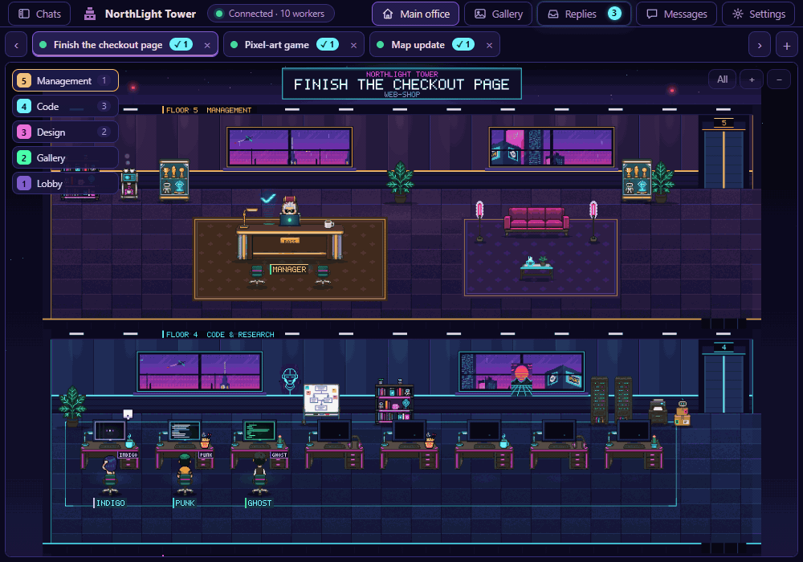
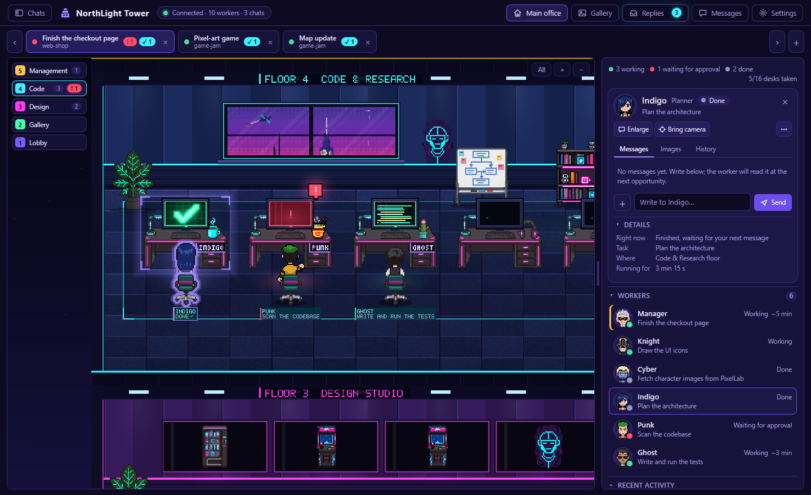
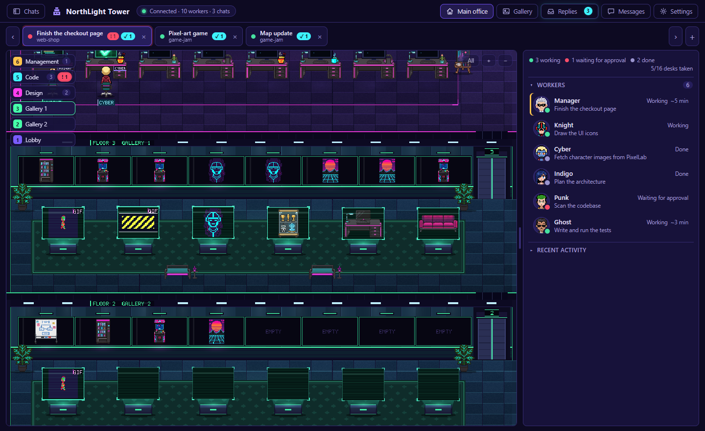

English | [Türkçe](README.tr.md)

# NorthLight Tower (Pixel Office)

**A local pixel-art cyberpunk tower that shows your live Claude Code / Claude Desktop sessions as an office full of workers.**

When you run Claude with several subagents, it is hard to tell who is doing what, who is stuck waiting for your approval, and who has already finished. NorthLight Tower reads Claude's local session logs and draws each chat as its own office: the chat's main agent sits in the manager's room, and every subagent it starts walks in through the door and takes a desk. You see at a glance who is working, who needs approval, and who is done. With the optional plugin you can also message a worker, stop it, look at the images it produced, and read its final answer on a comfortable screen.

It does not call any model and does not add anything to Claude's context, so it costs no tokens by itself.

**Free and open source (MIT).** Download the ready-made zip from the [Releases page](https://github.com/Fediac/northlight-tower/releases) or from [itch.io](https://fediac.itch.io/northlight-tower). If it saves you time and you'd like to support development, you can leave a tip on the [itch.io page](https://fediac.itch.io/northlight-tower) ("pay what you want", $0 is fine).

> **Language:** the interface is in **English** by default. Turkish (Türkçe) is built in: choose it in **Settings > Language**; the page reloads to apply it.

## Quick start

You need **Python 3**. Nothing else to install (standard library only).

- **Windows:** run `CreateShortcut.bat`. It puts a "NorthLight Tower" icon on your desktop; double-click it to open the tower. Without the shortcut: `Start.bat`.
- **Mac / Linux / anyone:** in the project folder run `python server.py`, then open **http://127.0.0.1:8765** in your browser. Stop it with **Ctrl+C** in the terminal.
- Different port: `NORTHLIGHT_PORT=8790 python server.py` (Windows PowerShell: `$env:NORTHLIGHT_PORT=8790; python server.py`). See the port note under [Troubleshooting](#troubleshooting).

Then just use Claude Code as usual. Any chat that was active in the last 2 hours shows up as an office.

To message or stop workers from the tower, also install the plugin: `AddPlugin.bat` on Windows, or `python plugin_setup.py add` elsewhere (see [The Pixel Office plugin](#the-pixel-office-plugin)).

## Platform notes (honest version)

- **Tested on Windows only.**
- The `.bat` / `.vbs` files, the app-style window (Edge `--app`) and the "keep window on top" setting are Windows-only.
- `server.py` also starts on Mac/Linux and reads Claude's logs from `~/.claude/projects`, but it has **not been tested** on those platforms. You open the page in your browser yourself.

## Features

- **One office per Claude chat**, with tabs, a manager, and subagents as workers.
- **Floors that grow with the work**: code and design floors, a gallery, a lobby, and an elevator between them.
- **Live status** for every worker: *Working*, *Waiting for approval*, *Done*, plus what it is doing right now ("Writing a file"...).
- **Hologram pop-ups** when a task finishes or needs approval, a replies list, and a reading screen.
- **Gallery** of every image, GIF and video your workers produced, kept even after the worker is gone.
- **Talk to workers** (with the plugin): send a message, stop a task, revise, retry, attach files.
- **English and Turkish** interface (switch in Settings > Language).
- **9 world themes** (cyberpunk, gothic lighthouse, wizard tower, retro space station, steampunk, noir, samurai castle, post-apocalyptic bunker, Wild West).
- **Lightweight**: about 1% CPU and about 25 MB RAM for the server; the page only draws visible floors.
- **Local only**: binds to `127.0.0.1`, read-only access to Claude's logs, no telemetry.

## Launch files

| File | What it does |
|---|---|
| `CreateShortcut.bat` | **Puts a "NorthLight Tower" icon on your desktop** (the NorthLight eye). Double-click: the tower starts in the background and opens in a small app window. |
| `Start.bat` / `Start.vbs` | Does the same by hand (`.vbs` starts it without showing a console window; the shortcut uses this one). |
| `Stop.bat` | Stops the tower. **Run this first before updating.** |
| `AddPlugin.bat` / `RemovePlugin.bat` | Makes Claude load the Pixel Office plugin in every chat and adds the `SendMessage` permission rule / removes both (see below). |
| `RemovePermission.bat` | Removes only the `SendMessage` permission rule (the plugin stays; messages go through the main agent). |

Python is required; nothing else. Address: `http://127.0.0.1:8765`

## One office per chat (tabs)

The tab bar at the top has one tab per active Claude chat: the chat title, with the project name under it.
A tab only shows two small badges: red **! n** (n workers waiting for approval) and cyan **✓ n** (n unread answers).
Click a tab, or use the **‹ ›** buttons / **Ctrl + ← →** (or **Alt + 1…9**) to switch chats. Each office remembers its own camera position and selected worker.
The sign on the roof also shows that chat's title and project. If a worker in another chat needs approval, you still get a beep and the page title changes.
A chat that has been idle for 2 hours closes its tab automatically (it comes back as soon as it does something again).

There is also a left sidebar listing your recent Claude Code chats grouped by project folder (like Claude Desktop's sidebar), with search; clicking one opens it as a tab.

## Floors grow with the work

Each office starts with only the floors it needs; when desks or picture frames run out, **a floor is added automatically** (it shrinks back only after 25 seconds of calm, so it doesn't flicker).

| Floor | Who is here | What's there | Growth |
|---|---|---|---|
| **Management** | That chat's manager | Large desk, laptop (logo glows in the status color, ✓ when done), coffee, trophy shelf | always 1 |
| **Code & Research** | Code / test / research workers | 8 desks, whiteboard, shelves | +1 floor per 8 workers (max 3) |
| **Design Studio** | Workers doing image / pixel art / PixelLab work | 8 desks, 5 wall frames (newest images), easel | +1 floor per 8 workers (max 3) |
| **Gallery** | nobody (everything produced is exhibited here) | 8 wall frames + 6 **hologram pedestals** (animated GIFs / videos play on the pedestals) | opens when there are more than 5 images, +1 floor per 14 images (max 3) |
| **Lobby & Lounge** | Workers on a break | Sofa, armchairs, arcade machine, balcony, notice board, reception, entrance | always 1 |

Workers take the **elevator** between floors. The department is inferred from the worker's type, its tools and its task text.
If all desks are taken, newcomers stand and wait in the lobby (the side panel says "n waiting in the lobby").

## How workers behave

- Every worker has a **fixed name and face** (Ghost, Indigo, Knight...); the manager is simply "Manager". The same worker has the same name everywhere:
  above its head, on the name plate in front of its desk, in lists, and in messages.
- When a worker finishes, it **stays seated at its desk**; a **green neon ✓** lights up on its monitor.
- Now and then a worker takes a break on its own (sofa, arcade, balcony...) and walks back to its desk afterwards. (Can be turned off in Settings.)
- If **work arrives or you message it** while it is on a break or walking, it **teleports back to its desk** in a beam of light.
- Status always uses the same three words: **Working**, **Waiting for approval**, **Done**. While working, it also shows what it is doing ("Writing a file"...).
- While the manager hands out work, an "ASSIGNING TASK.." bubble appears over its head; workers start with a short one-line task.
- Hovering over a worker or **its desk** draws a neon outline; clicking the desk of a worker who is on a break also moves the camera and the card to that worker.

## When a task finishes

When the work is done and Claude writes its answer, a **"TASK DONE" hologram** pops up from the tower: **Read** opens the answer on a comfortable reading screen, **OK** closes it.
If approval is needed, an **"APPROVAL NEEDED"** hologram tells you which worker wants to do what. You still approve in the Claude window (the tower does not grant approvals).
The **Replies** button in the top bar lists finished tasks: reread any of them, or clear them with "Mark all as read".
The reading screen has **Copy**, **Previous / Next** and **Close** (Esc also closes it).

**Claude's questions:** when Claude asks you a multiple-choice question (`AskUserQuestion`), the plugin can hand it to the tower, which shows a question card in the bottom-right corner. Your answer goes back to Claude, so you don't need to switch windows. If nobody answers within 10 minutes, the question is asked in the Claude window instead.

## Gallery, GIFs and videos

- **Click** the frames on the design floor, the gallery walls and the hologram pedestals **to enlarge** them (pixel art stays sharp; use ‹ › to browse all images; **Revise...** fills the message box with a ready-made sentence).
- **GIF / animated WEBP** play both in the world and when enlarged, and so do **MP4 / WEBM** videos (frames show a "GIF" / "VID" badge). Can be paused in Settings.
- Images are collected from the workers' tool results (e.g. PixelLab links), from `[Image: source: …]` lines, and from `.gif/.mp4/.webm` files they create with commands.

## Gallery screen (past images, GIFs and videos)

The **Gallery** button in the top bar opens a phone-style gallery: **all** images, animations and videos your workers produced, in a grid grouped by day.
An image stays even if its worker has finished, **has been removed from the office**, or has dropped out of the logs (the server keeps them in `_cache/gallery.json` and `_cache/gal/`; at most 800 items, oldest are deleted).
At the top: type filter (All / Images / Animations / Videos), search, and a worker filter. Click an item to enlarge it: **← →** (or the buttons) move to the next one, **Esc** closes the enlarged view first, then the gallery.
On the right you see the **worker's name, task and status** (Working / Finished / Left the office / Not in the logs), and below that a **command box** for that worker ("slow the animation down", for example).
If the worker has left the office, it is **called back in first** when you send a command; if it is gone from the logs entirely, the command is passed to the manager together with the image and the worker's name. Writing to a finished worker wakes it up again (costs as much quota as a normal message). Data comes from `GET /gallery`.

## Talking to workers

Click a character (or its row in the list) to open its card in the right panel. The card's buttons:

- **Expand:** opens the **Messages** window full-size (like Teams: workers on the left, the conversation on the right). The **Messages** button in the top bar opens the same window.
- **Bring camera:** moves the camera to that worker.
- **Stop:** interrupts the worker's current task. Stopping the manager takes two steps ("Are you sure?"; a second click within 4 seconds), so you don't cut off work by accident.
  "Stop" is not sent to a worker that has already finished (so it doesn't wake up and use quota).
- **⋯:** *Status summary* (an instant summary from what the office already knows; it does not ask Claude anything and uses no quota), *Revise...*, *Retry* (only if finished) and *Remove from office*.
- *Revise...* and *Retry* **do not send anything**; they fill the message box with a ready-made sentence and you press Send yourself (so nothing goes out by mistake).

You can attach files to a message with the "+" button, drag-and-drop, or Ctrl+V. Allowed file types and sizes are enforced by the server.

The card's **Messages** tab shows the latest conversation, **Images** shows what the worker produced, and **History** shows its recent actions in plain sentences.
On long answers, **Read more** takes you to the start of that message in the Messages window.

**Remove from office:** takes a finished worker out of the tower. Nothing is deleted; you can bring it back from the **Left the office** list in the right panel (with its face and name) using **Bring back**,
and the "Undo" notice that appears when you remove it does the same.

Messaging and Stop require the **Pixel Office plugin** to be running in that worker's chat (see below). Without it, the message box stays disabled and says why.
The status chip at the top also says "Connected · … · messaging off".

**You can also write from Claude's own side panel:** the plugin adds a **worker picker + message box** to the side panel (Enter or Send).
Messages you send there also appear in the tower's conversation.

**Direct delivery and the permission rule:** when Claude is in "auto mode", it does not treat a message you send from the tower as a request from the model, and refuses direct delivery. `AddPlugin.bat` adds the rule `permissions.allow: ["SendMessage"]` to your settings, so the message goes **directly** to the worker and does not touch the main agent's context. Without the rule, the plugin hands the message to the main agent as "forward this exactly"; it still works, but every message uses one step of the main agent.
The rule is global, so it also pre-approves the model's own `SendMessage` calls; if you don't want that, run `RemovePermission.bat`.

## Settings

**Settings** in the top bar opens a drawer on the right. Sections fold (only *Appearance* is open at first; your open/closed choice is remembered):

- **Language:** English (default) or Türkçe. The page reloads to apply it.
- **Theme:** the tower's world. 9 theme cards: Cyberpunk tower (default), Gothic lighthouse, Wizard tower, Retro space station, Steampunk clock tower, Noir detective office, Samurai castle, Post-apocalyptic bunker, Wild West town. It switches instantly: floor art, furniture, monitors, the view outside the windows, particles such as rain / sakura / dust, floor names (e.g. "Sheriff's Office", "Captain's Cabin") and sign colors. The system, layout and workers stay the same.
- **Theme color:** the interface colors. *Background:* Purple night, Black, or **Theme tone** (takes the color of the selected world theme); *Accent color:* **Match theme** (A), violet, cyber blue, neon pink, emerald, amber, crimson, copper.
- **Appearance:** text size, name labels, desk name plates.
- **Hover highlight:** worker and desk outline (color, thickness, glow).
- **Workers:** breaks and how often, ✓ on the monitor of finished workers, teleport effect.
- **Notifications:** hologram when a task finishes, beep while waiting for approval / when a task finishes.
- **Window:** keep on top of other windows (Windows, in the app window), compact view, full screen.
- **Advanced:** frame rate (smooth / power saving), animated gallery, rain and city motion, **Demo office** (fake workers), performance strip, reset settings, list of shortcuts.

You can widen or narrow the right panel by **dragging** the handle on either edge (300–720 px; also with the ←/→ keys; double-click resets it).
Panel sections such as *Details* and *Recent activity* fold open and closed with the arrows.

## How themes work (developer notes)

Each theme lives in `assets/themes/<id>/`: `theme.json` (colors, floor names, sky / particles, `files` list), `bg/` (5 floor strips + glass, sky layers), `f/` (furniture, `monitor.png`, `exec_device.png`).
**All sizes are exactly the same as in cyberpunk in every theme** (desk 80×57, monitor frame 46×32 with a 38×22 screen opening, gallery frames 96×45 / 100×50, pedestals, all furniture), so the layout (`scene.json`) never changes. Any missing file falls back to cyberpunk.
Pipeline: `python tools/theme_sprites.py spec` (list of parts) → generate parts with PixelLab (`tools/THEME_ART_BRIEF.md`) → `python tools/theme_sprites.py fit <theme> <name> <png>` → `python compose_theme.py <theme|all> --preview` (floor strips, monitor, `theme.json`). Colors and textures are in `theme_defs.py`.
The selected theme is `theme` in `PO.settings`; runtime values are in `PO.TH`. When the theme changes, the images are loaded and swapped in a single step.

**Themed characters (optional):** `assets/themes/<theme>/atlas/<slot>.png` + `atlas/atlas.json` (same slot names: hacker, punk, …, mudur, mudire; same row layout, 100×100 cells, foot anchor identical to cyberpunk) and `faces/<slot>.png` (panel / chat faces). `PO.switchTheme` in `core.js` picks these up from the `files` list in `theme.json`; any character that is missing comes from the cyberpunk atlas (`PO.AT_BASE` / `PO.IM_BASE`), and `PO.faceUrl` follows the same rule for faces.
Pipeline: PixelLab `create_character` (standard, size 48 → 68 px canvas; managers size 54) + `animate_character` (`walking-6-frames` template + v3 custom clips: type/rest/vape/wave/think; manager: type/think/wave/coffee) → `python -I tools/pl_fetch.py <theme> <slot> <uuid>` (raw files go to `_work/themechars/<theme>/<slot>/`) → `python tools/build_theme_chars.py <theme> [slot…]` → `python tools/make_faces.py --theme <theme>`.
Always put "no desk, no keyboard, no objects" in the typing-clip prompt (the model sometimes invents a desk). Cost is about 10 generations per character (16 characters ≈ 160).

## Camera and keys

**Mouse wheel** scrolls between floors, **Ctrl + wheel** zooms, drag to pan, double-click fits the floor.
The **floor buttons** on the left jump to a floor (digit = floor, number = workers on that floor, red = waiting for approval); in a narrow window only the colored number remains. **All** shows the whole tower.
↑ ↓ change floor · Ctrl + ← → change chat · Esc closes the open window first (reader, settings, Replies, Messages), then clears the selection.
While a window is open, the arrow keys don't move the camera and Tab focus doesn't escape to the tower behind it.
The **Demo office** tries everything with three fake chats (`?demo=1&n=24` for 24 workers, `&art=16` to test the gallery floor).

## Resource use

- **No tokens.** Neither the tower nor the plugin ever calls a model or adds anything to the context. Only when you message a worker does that worker run a real step (as much as a normal chat message). *Status summary* and the Replies list use no quota.
- The server uses about 1% CPU and about 25 MB of memory. The page: the camera updates every frame (smooth scrolling); the world is drawn at ~30 fps while something is happening and **~15 fps when idle** (also ~15 when the window is in the background). Measured on the author's machine (same scene, app window): about 14% of one CPU core when idle (about 21% in v3). Fast drawing continues while a worker is selected, the mouse is over a desk, a GIF is playing, or someone is walking.
  **Only floors visible on screen are drawn**, so more floors do not slow it down. When the window is minimized or covered by another window, the browser stops drawing on its own. Turn on measurements with *Performance strip* in Settings, or `?perf=1`.
- **It doesn't stay running forever:** if there is no browser tab and no Claude activity for 30 minutes, it shuts itself down (set `NORTHLIGHT_NO_EXIT=1` to keep it running). The plugin tries to restart the tower when a new chat starts and the tower is off; if that fails, use the shortcut / `Start.bat`.

## Privacy and security

Your data stays on this computer.

- The server listens **only on `127.0.0.1`** and **only reads** Claude's session logs (`~/.claude/projects/**/*.jsonl`). It never writes to them.
- The tower itself calls no model and sends nothing to Anthropic or anyone else. There is no telemetry, no analytics, and no account.
- The **only outgoing requests** in the code: when Claude's output contains a public image/video URL, the server downloads it once with a plain GET so it can show it in the gallery, and stores it in the local `_cache/` folder. No user data is sent. Addresses that resolve to local/private networks are rejected, redirects are checked the same way, and size is capped (12 MB per image, 40 MB per video). The web page loads no external scripts, fonts or CDNs.
- Message, stop, remove and window actions are protected by a **token** and an origin check, so another web page cannot write to your workers on your behalf.
- The plugin only talks to the tower on `127.0.0.1:8765`.
- `AddPlugin.bat` / `python plugin_setup.py add` changes your `~/.claude/settings.json` (only `env.CLAUDE_CODE_PLUGIN_DIRS` and the `SendMessage` entry in `permissions.allow`) and makes a backup first. `RemovePlugin.bat` undoes it.

## The Pixel Office plugin

(Side panel + exact events + messaging.) Lives in `mod/pixel-office/`. `AddPlugin.bat` (or `python plugin_setup.py add`) adds the plugin to Claude's global settings (`env.CLAUDE_CODE_PLUGIN_DIRS`), so it loads automatically in every new chat.
To undo: `RemovePlugin.bat` (or `python plugin_setup.py remove`). What it does:

- Opens a side panel inside Claude (can be closed, `/pixel-office`): worker picker + **message box**.
- Captures permission requests, tool calls and new workers **exactly** (instead of guessing from the logs), so you can see what workers are doing while they work.
- Delivers the messages you write in the tower or the panel, and passes the reply and any images it produced back to the tower. It also carries **Stop** requests and Claude's questions.

**Version compatibility:** chats that are already open in Claude keep the old plugin in memory; a new version only takes effect in newly opened chats (or after Claude is restarted).
If you are upgrading from an earlier version (the plugin folder used to be called `mod/piksel-ofis`), run `AddPlugin.bat` once more: it replaces the old entry in Claude's settings with the new folder.
In a chat with an old plugin, *Stop* says that the plugin in this chat is out of date and Stop will work after restarting Claude; the tower doesn't send an empty message to that chat.
Sending messages works with the old plugin too.

## Files

| Path | Contents |
|---|---|
| `server.py` | Log watcher + small web server (state, names, answers, chat, image/video cache, window actions). Only serves the office's own files. |
| `office.html` `office.css` `theme.css` `ui.css` | Page, theme variables (Purple night / Black), shared components (folding section, tooltip, notification) |
| `settings.js` `settingsui.js/.css` | Settings storage + Settings drawer |
| `i18n.js` `tr_*.js` | Language support: `PO.t()` helpers, and the Turkish translation tables (English is the source text in the code; add another language by writing a new `tr_*.js`-style table) |
| `core.js` `tower.js` `agents.js` `draw.js` `cam.js` | Shared helpers · floor list / path network / elevator · worker behavior · drawing (visible floors only) · camera |
| `gallery.js/.css` | Gallery screen: grid of past images, enlarge, command to worker (server: `/gallery`) |
| `panel.js/.css` `chat.js/.css` `inbox.js/.css` | Right panel + worker card · Messages window · Answers, hologram and reading screen |
| `session.js` `main.js` `api.js` `ui.js` `md.js` | Chat = office, tabs, automatic floors · startup and loop · server calls (faked in demo mode) · shared helpers · safe markdown |
| `nav.js` | Left sidebar: recent Claude Code chats grouped by project |
| `questions.js/.css` | Question card for Claude's `AskUserQuestion` |
| `attachments.js/.css` | File attachments in the message box |
| `assets/` | Characters (atlas, 16 people), faces (`faces/`), names (`names.json`), furniture, floor strips (`bg/`), icon. Art made with PixelLab |
| `scene.json` `font5x7.json` | Layout of each floor type and the pixel font |
| `compose_tower.py` `compose_shell.py` `build_assets.py` | Draw the floor strips and turn raw PixelLab output into the atlas + furniture (development) |
| `theme_defs.py` `compose_theme.py` `tools/theme_sprites.py` | Theme definitions (color, texture, sky) · theme floor strip / monitor / manifest builder · tool that fits a PixelLab part to full size |
| `assets/themes/` | Theme art (each theme: `theme.json`, `bg/`, `f/`) |
| `tools/` | Face generation, tower tests (`python tools/test_server.py`) |
| `mod/pixel-office/` | Claude plugin (tests: `claude plugin test`) |
| `plugin_setup.py` | Adds / removes the plugin in the global settings |
| `_tower.ps1` | Start / stop logic behind `Start.bat`, `Stop.bat` and the desktop shortcut. It recognizes this tower by its `X-NorthLight-Tower` response header and never touches other programs that use the port |

## Troubleshooting

- The top says "The tower is off. Double-click Start.bat.": double-click the shortcut or run `Start.bat`.
- A different page opens, or you see "Port 8765 is used by another program": some other program (often a forgotten `python -m http.server 8765`) holds the port. `Start.bat` names the program; close it and start again. The server also refuses to start on a busy port, and `Stop.bat` only ever stops NorthLight Tower itself.
- If the page loads only halfway, it reloads itself after 4 seconds; if that doesn't help, the screen tells you what to do (F5, otherwise `Stop.bat` then `Start.bat`).
- No workers at all: no Claude chat has been active in the last 2 hours. Try the **Demo office** (Settings > Advanced).
- A tab is missing: that chat has done nothing in the last 2 hours; it comes back once you send it a message.
- The message box is disabled: the Pixel Office plugin isn't running in that chat. After `AddPlugin.bat` it loads automatically in newly opened chats.
- If you close the Claude window, messaging and Stop stop working for those chats (the plugin isn't running); the tower keeps watching by reading the logs.
  Whether Claude keeps running in the background after you close its window with X is Claude's own behavior; the tower doesn't affect it.
- "Keep on top" doesn't work: the tower window must be in the foreground when you press the button (Edge/Chrome app window).
- Port 8765 is taken: set a different port with the `NORTHLIGHT_PORT` environment variable. Note that the plugin and `Start.bat` are hard-wired to 8765, so on another port only the read-only view works (no messaging, Stop or question cards), and you open the page yourself.
- When the tower restarts, the page reloads itself; it won't reload while a window is open or while you are typing, and shows a "New version: reload" button instead.

## Recording a demo GIF

1. Turn on Settings > Advanced > **Demo office** (fake workers, none of your real chats are shown) and open the tower in a small window.
2. Record 10–15 seconds, at most 800 px wide, with ScreenToGif (Windows) or Peek / Kap (Linux / Mac).
3. Save it as `docs/demo.gif`.

## Contact

NorthLightStudios: northlightstudios25@gmail.com

## License

MIT. See the `LICENSE` file.
