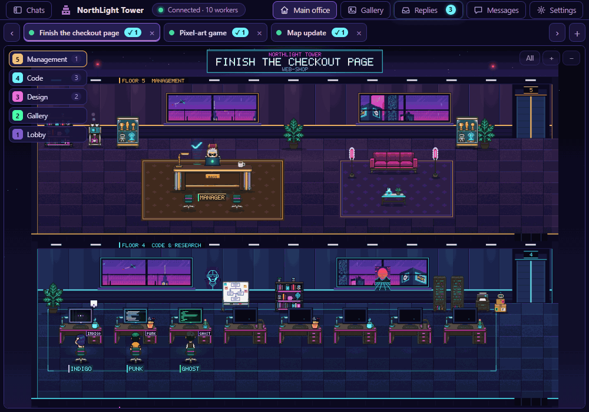
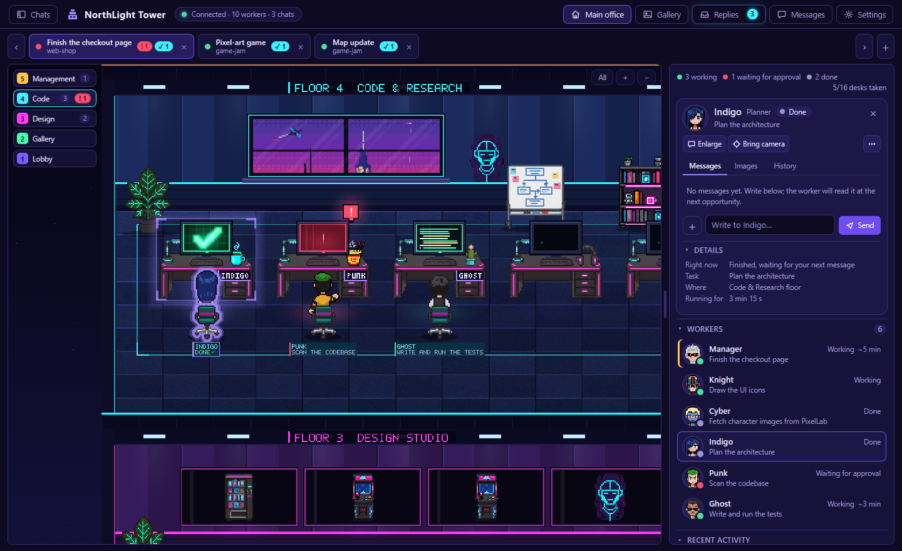
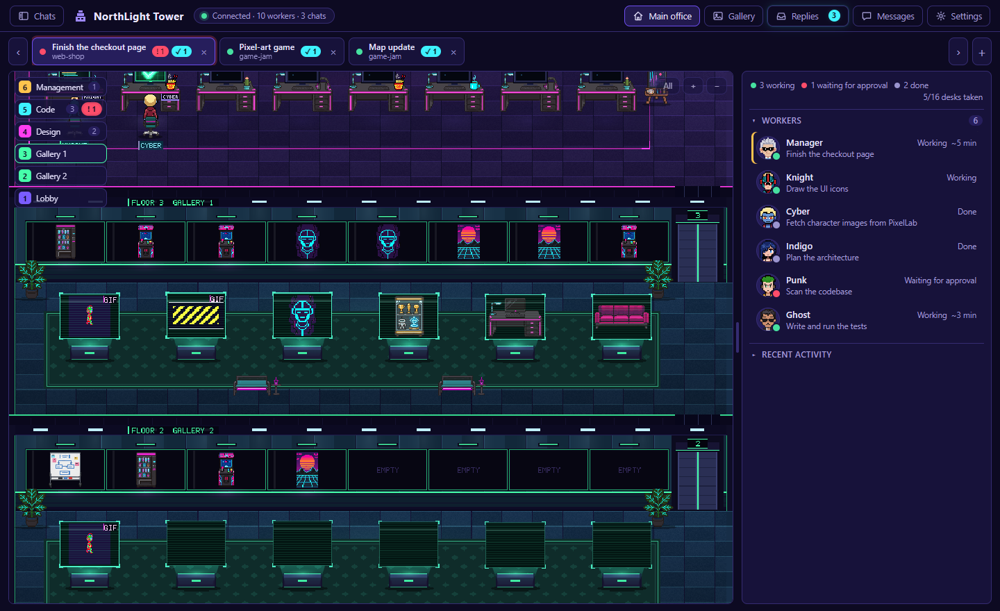

[English](README.md) | Türkçe

# NorthLight Tower — Piksel Ofis

**Ücretsiz ve açık kaynak (MIT).** Hazır zip için [Releases](https://github.com/Fediac/northlight-tower/releases) sayfasına ya da [itch.io](https://fediac.itch.io/northlight-tower) sayfasına bak. Destek olmak istersen itch.io sayfasından isteğe bağlı bağış bırakabilirsin (0 $ da olur).

> **Dil:** Arayüz varsayılan olarak **İngilizcedir**. Türkçe için **Ayarlar > Dil** bölümünden Türkçe'yi seç (sayfa yenilenir). Bu belgedeki ekran adları Türkçe arayüze göredir.

## Hızlı başlangıç

- **Windows:** `CreateShortcut.bat` masaüstüne simge koyar; çift tıklayınca kule açılır. Kısayolsuz: `Start.bat`.
- **Mac / Linux / herkes:** klasörde `python server.py` çalıştır (Python 3 yeterli, başka kurulum yok), sonra tarayıcıda **http://127.0.0.1:8765** adresini aç. Durdurmak için terminalde **Ctrl+C**.
- Başka port için: `NORTHLIGHT_PORT=8790 python server.py` (Windows PowerShell: `$env:NORTHLIGHT_PORT=8790; python server.py`).

Dürüst not: `.bat` / `.vbs` dosyaları, uygulama penceresi (Edge `--app`) ve "Pencereyi üstte tut" ayarı yalnızca Windows içindir. `server.py` Mac/Linux'ta da başlar ve Claude kayıtlarını `~/.claude/projects` altından okur; ancak bu platformlarda yalnızca Windows'ta denenmiştir, pencereyi kendin tarayıcıda açarsın.

Claude Code / Claude Desktop (Code sekmesi) çalışanlarını **cyberpunk bir kulede, canlı** gösterir.
**Her Claude sohbetinin kendi ofisi var:** sohbetin müdürü kendi odasında oturur, onun başlattığı çalışanlar kapıdan girer.
Kim nerede, ne yapıyor bir bakışta görünür; istersen tek tıkla bir çalışana yazar, durdurur, ürettiği görselleri büyütüp bakar,
iş bitince cevabını rahat bir ekranda okursun.

## Başlatma

| Dosya | Ne yapar |
|---|---|
| `CreateShortcut.bat` | **Masaüstüne "NorthLight Tower" simgesi koyar** (NorthLight gözü). Çift tık: kule arka planda açılır, küçük bir uygulama penceresinde gelir. |
| `Start.bat` / `Start.vbs` | Aynısını elle yapar (`.vbs` konsol penceresi göstermeden başlatır; kısayol bunu kullanır). |
| `Stop.bat` | Kuleyi kapatır. **Güncelleme yaparken önce bunu çalıştır.** |
| `AddPlugin.bat` / `RemovePlugin.bat` | Piksel Ofis eklentisini her Claude sohbetinde otomatik yükler + `SendMessage` izin kuralını ekler / ikisini de geri alır (aşağıya bak). |
| `RemovePermission.bat` | Yalnızca `SendMessage` izin kuralını geri alır (eklenti kalır; mesajlar ana çalışan üzerinden gider). |

Python gerekir (kurulu). Başka bir şey kurmak gerekmez. Adres: `http://127.0.0.1:8765`

## Her sohbetin kendi ofisi (sekmeler)

Üstteki sekme çubuğunda her aktif Claude sohbeti için bir sekme olur: sohbet başlığı, altında proje adı.
Sekmede yalnızca iki küçük işaret çıkar: kırmızı **! n** (n çalışan onay bekliyor) ve camgöbeği **✓ n** (n okunmamış yanıt).
Sekmeye tıkla ya da **‹ ›** düğmeleri / **Ctrl + ← →** (ya da **Alt + 1…9**) ile sohbetler arasında geç. Her ofisin kamerası ve seçili çalışanı ayrı hatırlanır.
Çatıdaki tabela da o sohbetin başlığını ve projesini yazar. Başka bir sohbette onay bekleyen olursa bip + sekme başlığı yine uyarır.
2 saattir hareketsiz sohbetin sekmesi kendiliğinden kapanır (yeniden bir şey yapınca geri gelir).

## Kat sayısı iş büyüdükçe artar

Her ofis yalnızca gerekli katlarla başlar; masa ya da görsel yetmeyince **kat kendiliğinden eklenir** (küçülme 25 sn sakinlikten sonra, titremesin diye).

| Kat | Kim burada | Ne var | Büyüme |
|---|---|---|---|
| **Yönetim** | O sohbetin müdürü | Geniş masa, laptop (logosu durum renginde yanar, iş bitince ✓), kahve, kupa vitrini | her zaman 1 |
| **Kod & Araştırma** | Kod/test/araştırma çalışanları | 8 masa, beyaz tahta, raflar | 8 çalışan başına +1 kat (en çok 3) |
| **Tasarım Stüdyosu** | Görsel/piksel/PixelLab işi yapanlar | 8 masa, 5 duvar çerçevesi (en yeni görseller), şövale | 8 çalışan başına +1 kat (en çok 3) |
| **Galeri** | — (üretilen her şey burada sergilenir) | 8 duvar çerçevesi + 6 **hologram kürsü** (hareketli GIF/video kürsüde oynar) | görsel sayısı 5'i geçince açılır, 14 görsel başına +1 kat (en çok 3) |
| **Lobi & Dinlenme** | Mola verenler | Kanepe, koltuklar, atari, balkon, pano, resepsiyon, giriş kapısı | her zaman 1 |

Kat değiştirmek için çalışanlar **asansörü** kullanır. Bölüm, çalışanın türünden/araçlarından/görev metninden anlaşılır.
Masalar dolarsa yeni gelen lobide ayakta bekler (yan panelde "n lobide bekliyor" yazar).

## Çalışanlar nasıl davranır

- Her çalışanın **sabit bir adı ve yüzü** vardır (Hayalet, Deniz, Şövalye…); müdür "Müdür" ya da "Müdire". Aynı çalışan her yerde aynı adla geçer:
  başının üstünde, masasının önündeki plakada, listede, mesajlarda.
- İş bitince çalışan **masasında oturmaya devam eder**; monitöründe **yeşil neon ✓** yanar.
- Ara sıra kendi isteğiyle molaya çıkar (kanepe, atari, balkon…); mola bitince masasına yürür. (Ayarlar'dan kapatılabilir.)
- Molada ya da yoldayken ona **iş gelir / mesaj yazarsan** ışın sütunuyla **kendiliğinden masasına ışınlanır**.
- Durum her yerde aynı üç sözle söylenir: **Çalışıyor**, **Onay bekliyor**, **Bitirdi**. Çalışırken ne yaptığı da yazar ("Dosya yazıyor"…).
- Müdür iş dağıtırken başının üstünde "GÖREV TANIMLANIYOR.." balonu çıkar; çalışanlar kısa bir görev cümlesiyle başlar.
- Fareyle bir çalışanın ya da **masasının** üstüne gelince neon çerçeve yanar; molada olanın masasına tıklasan da kamera ve kart ona gider.

## Görev bitince

İş bitince Claude cevabı yazdığında kuleden **"GÖREV BİTTİ" hologramı** açılır: **Oku** cevabı rahat bir okuma ekranında açar, **Tamam** kapatır.
Onay gerekiyorsa **"ONAY BEKLİYOR"** hologramı hangi çalışanın ne yapmak istediğini söyler; onayı yine Claude penceresinde verirsin (kule onay vermez).
Üst çubuktaki **Yanıtlar** düğmesi biten görevlerin listesidir: istediğini yeniden okur, "Tümünü okundu say" ile temizlersin.
Okuma ekranında **Kopyala**, **Önceki / Sonraki** ve **Kapat** var (Esc de kapatır).

## Galeri, GIF ve video

- Tasarım katındaki çerçevelere, galeri duvarına ve hologram kürsülere **tıkla → büyür** (piksel sanatı keskin kalır, ‹ › ile tüm görseller arasında gezersin, **Revize et…** yazı kutusunu hazır bir cümleyle doldurur).
- **GIF / animasyonlu WEBP** dünyada da, büyütünce de oynar; **MP4 / WEBM** videolar da (çerçevede "GIF" / "VID" rozeti çıkar). Ayarlar'dan durdurulabilir.
- Görseller çalışanın araç sonuçlarından (ör. PixelLab bağlantıları), `[Image: source: …]` satırlarından ve komutla ürettiği `.gif/.mp4/.webm` dosyalarından toplanır.

## Galeri (geçmiş görseller, GIF ve videolar)

Üst çubuktaki **Galeri** düğmesi, telefondaki galeri gibi bir ekran açar: çalışanların ürettiği **tüm** görseller, animasyonlar ve videolar günlere ayrılmış bir ızgarada durur.
Çalışan işini bitirmiş, **ofisten çıkarılmış** ya da kayıtlardan düşmüş olsa da görsel kalır (sunucu `_cache/gallery.json` ve `_cache/gal/` içinde saklar; en çok 800 öğe, eskiler silinir).
Üstte tür (Tümü / Görseller / Animasyonlar / Videolar), arama ve çalışan süzgeci var. Birine tıklayınca büyür: **← →** tuşlarıyla (ya da düğmelerle) sırayla diğerlerine geçilir, **Esc** önce büyütmeyi sonra galeriyi kapatır.
Sağda görseli üreten **çalışanın adı, görevi ve durumu** (Çalışıyor / Bitirdi / Ofisten çıkmış / Kayıtlarda yok) çıkar; altında o çalışana **komut kutusu** vardır ("animasyonu yavaşlat" gibi).
Çalışan ofisten çıkmışsa komut gönderilirken **önce ofise geri çağrılır**; kayıtlardan tamamen düşmüşse komut, görsel ve çalışan adıyla müdüre iletilir. Bitmiş bir çalışana yazmak onu yeniden uyandırır (normal bir mesaj kadar kota harcar). Veri `GET /gallery` ile gelir.

## Çalışanlarla konuşmak

Bir karaktere (ya da listede satıra) tıkla → sağ panelde kart açılır. Kartın düğmeleri:

- **Büyüt:** **Mesajlar** penceresini geniş ekranda açar (Teams gibi: solda çalışanlar, sağda konuşma). Üst çubuktaki **Mesajlar** düğmesi de aynı pencereyi açar.
- **Kamerayı getir:** kamerayı o çalışanın yanına götürür.
- **Durdur:** çalışanın o anki işini keser. Müdürü durdurmak iki adımlıdır ("Emin misin?"; 4 saniye içinde ikinci tık), yanlışlıkla işi kesmemek için.
  Zaten bitirmiş bir çalışana "Durdur" gitmez (yeniden uyanıp kota harcamasın).
- **⋯:** *Durum özeti* (ofisin elindeki bilgiden anında özet; Claude'a soru göndermez, kota harcamaz), *Revize et…*, *Tekrar dene* (yalnız bitirmişse) ve *Ofisten çıkar*.
- *Revize et…* ve *Tekrar dene* **mesajı göndermez**, yazı kutusunu hazır bir cümleyle doldurur; Gönder'e sen basarsın (yanlış gitmesin diye).

Kartın **Mesajlar** sekmesinde son konuşma, **Görseller** sekmesinde üretilenler, **Geçmiş** sekmesinde son hareketler (sade cümlelerle) durur.
Uzun cevaplarda **Devamını oku** seni Mesajlar penceresinde mesajın başına götürür.

**Ofisten çıkar:** bitmiş bir çalışanı kuleden kaldırır. Hiçbir şey silinmez; sağ paneldeki **Ofisten çıkanlar** listesinden (yüzü ve adıyla) **Geri getir** diyebilirsin,
çıkarınca çıkan "Geri al" bildirimi de aynı işi yapar.

Mesajlaşma ve Durdur, çalışanın sohbetinde **Piksel Ofis eklentisinin** çalışmasını ister (aşağıda). Eklenti yoksa kutu kapalı kalır ve nedenini yazar.
Üstteki durum çipi de "Bağlı · … · mesaj kapalı" der.

**Claude'un kendi yan panelinden de yazabilirsin:** eklenti yan panele bir **çalışan seçici + mesaj kutusu** ekler (Enter ya da Gönder).
Yazdığın mesaj kuledeki konuşmada da görünür.

**Doğrudan teslim ve izin kuralı:** Claude "otomatik mod"dayken, kuleden yazdığın mesajı bir modelin isteği saymaz ve doğrudan gönderimi
reddeder. `AddPlugin.bat`, ayarlara `permissions.allow: ["SendMessage"]` kuralını ekler; böylece mesaj çalışana **doğrudan** gider ve ana çalışanın
bağlamına dokunmaz. Kural yoksa eklenti mesajı ana çalışana "şuna aynen ilet" diye verir; yine çalışır, ama her mesaj ana çalışanın bir adımını harcar.
Kural genel olduğundan modelin kendi `SendMessage` çağrılarını da onaylı yapar; istemezsen `RemovePermission.bat`.

## Ayarlar

Üst çubuktaki **Ayarlar** sağdan bir çekmece açar; bölümler katlanır (yalnız *Görünüm* açık gelir, açık/kapalı seçimin hatırlanır):

- **Tema:** kulenin dünyası. 9 tema kartı: Siberpunk kule (varsayılan), Gotik deniz feneri, Büyücü kulesi, Retro uzay istasyonu, Steampunk saat kulesi, Noir dedektif bürosu, Samuray kalesi, Kıyamet sonrası sığınak, Vahşi Batı kasabası. Seçince anında değişir: kat görselleri, mobilyalar, monitörler, pencere dışı manzara, yağmur/sakura/toz gibi parçacıklar, kat adları (ör. "Şerif Bürosu", "Kaptan Köşkü") ve tabela renkleri. Sistem, yerleşim ve çalışanlar aynı kalır.
- **Tema rengi:** arayüzün renkleri. *Arka plan:* Mor gece, Siyah ya da **Tema tonu** (seçtiğin dünya temasının rengini alır); *Vurgu rengi:* **Temaya uy** (A), mor, siber mavi, neon pembe, zümrüt, amber, kızıl, bakır.
- **Görünüm:** yazı boyutu, ad etiketleri, masa plakaları.
- **Üzerine gelince vurgu:** çalışan ve masa çerçevesi (renk, kalınlık, parlama).
- **Çalışanlar:** mola ve sıklığı, bitirenin monitöründe ✓, ışınlanma efekti.
- **Bildirimler:** görev bitince hologram, onay beklerken / görev bitince bip.
- **Pencere:** başka pencerelerin üstünde tut (Windows, uygulama penceresinde), kompakt görünüm, tam ekran.
- **Gelişmiş:** kare hızı (akıcı / tasarruf), hareketli galeri, yağmur ve şehir hareketi, **Deneme ofisi** (sahte çalışanlar), ölçüm şeridi, ayarları sıfırla, kısayol listesi.

Sağ paneli iki ucundaki tutamaçtan **sürükleyerek** genişletip daraltabilirsin (300–720 px, ←/→ tuşlarıyla da; çift tık varsayılana döner).
Panelde *Ayrıntılar* ve *Son hareketler* gibi bölümler oklarla açılıp kapanır.

## Temalar nasıl çalışır (geliştirici notu)

Her tema `assets/themes/<kimlik>/` altındadır: `theme.json` (renkler, kat adları, gökyüzü/parçacık, `files` listesi), `bg/` (5 kat şeridi + cam, gökyüzü katmanları), `f/` (mobilyalar, `monitor.png`, `exec_device.png`).
**Boyutlar tüm temalarda cyberpunk ile birebir aynıdır** (masa 80×57, monitör çerçevesi 46×32 + 38×22 ekran deliği, galeri çerçeveleri 96×45 / 100×50, kürsüler, tüm mobilyalar), bu yüzden yerleşim (`scene.json`) hiç değişmez. Eksik dosya cyberpunk'tan gelir.
Üretim: `python tools/theme_sprites.py spec` (parça listesi) → PixelLab ile parça üretimi (`tools/THEME_ART_BRIEF.md`) → `python tools/theme_sprites.py fit <tema> <ad> <png>` → `python compose_theme.py <tema|all> --preview` (kat şeritleri, monitör, `theme.json`). Renkler/dokular `theme_defs.py` içindedir.
Seçili tema `PO.settings` içinde `theme`, çalışma anındaki değerler `PO.TH`; tema değişince görseller yüklenir ve tek adımda değiştirilir.
**Temalı karakterler (isteğe bağlı):** `assets/themes/<tema>/atlas/<yuva>.png` + `atlas/atlas.json` (aynı yuva adları: hacker, punk, …, mudur, mudire; aynı satır düzeni, 100×100 hücre, ayak çapası cyberpunk ile birebir) ve `faces/<yuva>.png` (panel/sohbet yüzleri). `core.js` `PO.switchTheme` bunları `theme.json` `files` listesinden görür; olmayan karakter cyberpunk atlasından gelir (`PO.AT_BASE` / `PO.IM_BASE`), yüzler için `PO.faceUrl` aynı kuralı izler. Üretim: PixelLab `create_character` (standard, size 48 → 68 px tuval; yöneticiler size 54) + `animate_character` (`walking-6-frames` şablonu + v3 özel klipler: type/rest/vape/wave/think; yönetici: type/think/wave/coffee) → `python -I tools/pl_fetch.py <tema> <yuva> <uuid>` (ham dosyalar `_work/themechars/<tema>/<yuva>/`) → `python tools/build_theme_chars.py <tema> [yuva…]` → `python tools/make_faces.py --theme <tema>`. Yazma klibi isteminde mutlaka "no desk, no keyboard, no objects" yaz (model masa uydurabiliyor). Maliyet ≈ 10 üretim/karakter (16 karakter ≈ 160).

## Kamera ve tuşlar

**Fare tekerleği** katları kaydırır, **Ctrl + tekerlek** yakınlaştırır, sürükleyerek gezersin, çift tık kata sığdırır.
Soldaki **kat düğmeleri** kata götürür (rakam = kat, sayı = o kattaki çalışan, kırmızı = onay bekleyen); dar pencerede yalnız renkli numara kalır. **Tümü** tüm kuleyi gösterir.
↑ ↓ kat değiştirir · Ctrl + ← → sohbet değiştirir · Esc önce açık pencereyi (okuyucu, ayarlar, Yanıtlar, Mesajlar), sonra seçimi kaldırır.
Pencere açıkken ok tuşları kamerayı oynatmaz, Tab odağı arkadaki kuleye kaçmaz.
**Deneme ofisi** üç sahte sohbetle her şeyi dener (`?demo=1&n=24` ile 24 çalışan, `&art=16` ile galeri katı denemesi).

## Kaynak kullanımı ve gizlilik

- **Token yemez.** Kule de, eklenti de hiç model çağırmaz, bağlama bir şey eklemez. Yalnızca sen bir çalışana mesaj yazarsan
  o çalışanın gerçek bir adımı çalışır (normal bir sohbet mesajı kadar). *Durum özeti* ve Yanıtlar listesi kota harcamaz.
- Kule ≈ %1 işlemci, ≈ 25 MB bellek. Sayfa: kamera her ekran karesinde (akıcı kaydırma); dünya çizimi bir şey olurken ~30 kare/sn,
  **durgunken ~15 kare/sn** (pencere arka plandaysa de ~15). Bu makinede ölçüm (aynı sahne, uygulama penceresi): boşta tek çekirdeğin ≈ %14'ü
  (v3'te ≈ %21). Bir çalışan seçiliyken, fare bir masanın üstündeyken, GIF oynarken ya da biri yürürken hızlı çizim sürer.
  **Yalnızca ekranda görünen katlar çizilir**, bu yüzden kat sayısı artınca yavaşlamaz. Pencere küçültülünce ya da başka pencerenin altında kalınca
  tarayıcı çizimi kendiliğinden durdurur. Ayarlar'daki *Ölçüm şeridi* ya da `?perf=1` ile ölçüm açılır.
- Kule yalnızca `127.0.0.1`'e bağlanır. Mesaj, durdurma, çıkarma ve pencere işlemleri **jetonlu** ve kökenli denetimlidir;
  başka bir web sayfası senin adına çalışana yazamaz. Sohbet kayıtlarına hiçbir şey yazmaz (salt okunur). Kuleden dışarı yalnızca
  çalışanların ürettiği herkese açık görsel/video adresleri indirilir (yerel ağ adresleri reddedilir; görsel en çok 12 MB, video 40 MB, `_cache/` içinde saklanır).
- **Sürekli açık kalmaz:** 30 dakika boyunca ne tarayıcı sekmesi ne Claude hareketi olursa kendiliğinden kapanır
  (`NORTHLIGHT_NO_EXIT=1` ile kapanmaz). Eklenti, yeni sohbette kule kapalıysa yeniden başlatmayı dener; olmazsa kısayol / `Start.bat`.

## Piksel Ofis eklentisi (yan panel + kesin olaylar + mesajlaşma)

`mod/pixel-office/` (eklenti metinleri İngilizcedir). `AddPlugin.bat` eklentiyi Claude'un genel ayarına (`env.CLAUDE_CODE_PLUGIN_DIRS`) ekler: her yeni sohbette kendiliğinden yüklenir.
Geri almak için `RemovePlugin.bat`. Ne yapar:
- Claude içinde yan panel açar (kapatılabilir, `/pixel-office`): çalışan seçici + **mesaj kutusu**.
- İzin isteklerini, araç çağrılarını, çalışan doğuşunu **kesin** yakalar (kayıt tahmini yerine). Çalışanlar çalışırken de ne yaptıkları görünür.
- Kuleden / panelden yazdığın mesajları teslim eder, yanıtı ve ürettiği görselleri kuleye geri verir. **Durdur** isteğini de o iletir.

**Sürüm uyumu:** Claude'da zaten açık duran sohbetler eski eklentiyi bellekte tutar; yeni sürüm yalnızca yeni açılan sohbetlerde (ya da Claude yeniden açılınca) devreye girer.
Eski eklentili bir sohbette *Durdur*, o sohbetteki eklentinin eski sürüm olduğunu ve Claude yeniden açılınca çalışacağını söyler; kule o sohbete boş mesaj göndermez.
Mesaj göndermek eski eklentiyle de çalışır.

## Dosyalar

| Yol | İçerik |
|---|---|
| `server.py` | Kayıt izleyici + küçük web sunucusu (durum, adlar, yanıtlar, sohbet, görsel/video önbelleği, pencere işlemleri). Yalnızca ofis dosyalarını sunar. |
| `office.html` `office.css` `theme.css` `ui.css` | Sayfa, tema değişkenleri (Mor gece / Siyah), ortak bileşenler (katlanan bölüm, ipucu, bildirim) |
| `settings.js` `settingsui.js/.css` | Ayarların saklanması + Ayarlar çekmecesi |
| `i18n.js` `tr_*.js` | Dil desteği: `PO.t()` yardımcıları ve Türkçe çeviri tabloları (koddaki kaynak metin İngilizcedir; yeni dil için `tr_*.js` gibi bir tablo yazılır) |
| `core.js` `tower.js` `agents.js` `draw.js` `cam.js` | Ortak yardımcılar · kat listesi/yol ağı/asansör · çalışan davranışı · çizim (yalnızca görünen katlar) · kamera |
| `gallery.js/.css` | Galeri ekranı: geçmiş görseller ızgarası, büyütme, çalışana komut (sunucu: `/gallery`) |
| `panel.js/.css` `chat.js/.css` `inbox.js/.css` | Sağ panel + çalışan kartı · Mesajlar penceresi · Yanıtlar, hologram ve okuma ekranı |
| `session.js` `main.js` `api.js` `ui.js` `md.js` | Sohbet = ofis, sekmeler, otomatik katlar · başlatma ve döngü · sunucu işlemleri (test modunda sahte) · ortak yardımcılar · güvenli markdown |
| `assets/` | Karakterler (atlas, 16 kişi), yüzler (`faces/`), adlar (`names.json`), mobilya, kat şeritleri (`bg/`), simge — görseller PixelLab ile üretildi |
| `scene.json` `font5x7.json` | Kat türlerinin yerleşimi ve piksel yazı tipi |
| `compose_tower.py` `compose_shell.py` `build_assets.py` | Kat şeritlerini çizer ve ham PixelLab çıktısını atlas + mobilyaya çevirir (geliştirme) |
| `theme_defs.py` `compose_theme.py` `tools/theme_sprites.py` | Tema tanımları (renk, doku, gökyüzü) · tema kat şeritleri/monitör/manifest derleyicisi · PixelLab parçasını tam boyuta oturtan araç |
| `assets/themes/` | Tema görselleri (her tema: `theme.json`, `bg/`, `f/`) |
| `tools/` | Yüzleri üretir, kule testleri (`python tools/test_server.py`) |
| `mod/pixel-office/` | Claude eklentisi (testleri: `claude plugin test`) |
| `plugin_setup.py` | Eklentiyi genel ayara ekler/çıkarır (`python plugin_setup.py add` / `remove`) |
| `_tower.ps1` | `Start.bat`, `Stop.bat` ve masaüstü kısayolunun başlat / durdur mantığı. Bu kuleyi `X-NorthLight-Tower` yanıt başlığından tanır, aynı portu kullanan başka programlara dokunmaz |

## Sorun giderme

- Üstte "Kule kapalı. Start.bat'a çift tıkla.": kısayola çift tıkla ya da `Start.bat` çalıştır.
- Başka bir sayfa açılıyorsa ya da "Port 8765 başka bir program tarafından kullanılıyor" görürsen: portu başka bir program (çoğunlukla unutulmuş bir `python -m http.server 8765`) tutuyordur. `Start.bat` programın adını gösterir; onu kapatıp yeniden başlat. Sunucu dolu portta açılmayı reddeder, `Stop.bat` yalnızca NorthLight Tower'ı durdurur.
- Sayfa yarım açılırsa 4 saniye sonra kendini yeniler; olmazsa ekranda ne yapacağın yazar (F5, olmazsa `Stop.bat` sonra `Start.bat`).
- Hiç çalışan yoksa: son 2 saatte hareket eden bir Claude sohbeti yoktur. **Deneme ofisi** (Ayarlar > Gelişmiş) ile dene.
- Sekme görünmüyorsa: o sohbet son 2 saatte hiçbir şey yapmamıştır; bir mesaj yazınca geri gelir.
- Mesaj kutusu kapalıysa: o sohbette Piksel Ofis eklentisi çalışmıyordur. Yeni açılan sohbetlerde `AddPlugin.bat` sonrası kendiliğinden gelir.
- Claude penceresini kapatırsan o sohbetlerde mesaj ve Durdur gitmez (eklenti çalışmaz); kule kayıtları okuyarak izlemeye devam eder.
  Pencereyi X ile kapatınca Claude'un arka planda kalıp kalmadığı Claude'un kendi davranışıdır, kule buna karışmaz.
- "Üstte tut" çalışmazsa: düğmeye basarken kule penceresinin ön planda olması gerekir (Edge/Chrome uygulama penceresi).
- Port 8765 doluysa `NORTHLIGHT_PORT` ortam değişkeniyle başka port ver.
- Kule yeniden başlayınca sayfa kendini yeniler; bir pencere açıkken ya da mesaj yazarken yenilemez, "Yeni sürüm: yenile" düğmesi çıkar.

## Gizlilik

Veri yalnızca bu bilgisayarda kalır: sunucu yalnızca `127.0.0.1`'e dinler ve Claude'un kayıt dosyalarını (`~/.claude/projects`) yalnızca okur, onlara yazmaz. Kodda tek dışa dönük istek şudur: Claude'un çıktısında geçen herkese açık bir görsel/video adresi galeride gösterilsin diye bir kez indirilip yerel `_cache` klasörüne konur (yalnızca GET, hiçbir kullanıcı verisi gönderilmez; yerel ağ adresleri reddedilir). Telemetri, analitik ya da hesap yoktur.

## Ekran görüntüsü / demo

Demo GIF'i nasıl kaydedilir:
1. Ayarlar > Gelişmiş > **Deneme ofisi**'ni aç (sahte çalışanlar, gerçek sohbet görünmez), kuleyi küçük bir pencerede aç.
2. ScreenToGif (Windows) ya da Peek / Kap (Linux/Mac) ile 10-15 sn, en çok 800 px genişlikte kaydet.
3. Dosyayı `docs/demo.gif` olarak kaydet.

## İletişim

NorthLightStudios: northlightstudios25@gmail.com

## Lisans

MIT. Ayrıntı için `LICENSE` dosyasına bak.
